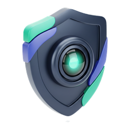

# 🛡️ NeoGuard — AI Camera Guard

<p align="center">
  
</p>

**100% Local Multi-Camera AI Security, Person Tracking, Face Recognition & 48-Hour Unknown Event Logging for RTSP / ONVIF IP Cameras.**

No cloud subscriptions, no external AI APIs: all video analysis (**YOLOv8n** person detection + **OpenCV YuNet** face detection + **SFace ONNX** 128-D embeddings) runs completely offline inside the Docker container.

---

## ✨ Key Features

### 1. Multi-Camera Management & Universal Compatibility
- **Simultaneous Background Monitoring:** Manage multiple cameras in parallel — switch quickly via camera pills or toggle the **All Cameras** 2-column live grid view.
- **Universal RTSP & ONVIF Presets:** Built-in templates for popular camera brands and open-source firmware, plus full custom configuration (`RTSP Port`, `ONVIF Port`, `RTSP Stream Path`, `ONVIF Profile Token`):

| Brand / Firmware Preset | RTSP Port | ONVIF Port | Default RTSP Path | ONVIF Profile Token |
| :--- | :---: | :---: | :--- | :--- |
| **TP-Link Tapo** (C200/C210/C500) | `554` | `2020` | `stream1` | `profile_1` |
| **Reolink** | `554` | `8000` | `h264Preview_01_main` | `main` |
| **Hikvision / Annke** | `554` | `80` | `Streaming/Channels/101` | `Profile_1` |
| **Dahua / Amcrest** | `554` | `80` | `cam/realmonitor?channel=1&subtype=0` | `MediaProfile000` |
| **Imou** | `554` | `80` | `cam/realmonitor?channel=1&subtype=0` | `MediaProfile000` |
| **Thingino** (Open-Source Firmware) | `554` | `80` | `ch0` | `Profile_0` |
| **Custom (RTSP / ONVIF)** | Custom | Custom | Custom path or full `rtsp://...` URL | Custom |

### 2. Local AI Face Recognition & 48h Unknown Event Log
- **Known Persons = OK:** Recognized household members only update their `last_seen` timestamp without spamming event logs or snapshots.
- **48-Hour Unknown Person Retention:** Unrecognized persons are logged with camera name badges and annotated snapshots, and automatically pruned after **48 hours** (`event_retention_hours: 48`).
- **In-Browser Crop & Enrollment:** Upload reference photos or capture directly from any camera with interactive crop/zoom/rotate editing.
- **Collapsible Persons Drawer:** Space-saving avatar preview bar with smooth expand/collapse drawer.

### 3. Live View, Digital Zoom & ONVIF PTZ Auto-Tracking
- **Live MJPEG Stream & Digital Zoom (`1.0x – 4.0x`):** Smooth zoom via slider, mouse wheel, and drag-to-pan.
- **Hold-to-Move ONVIF PTZ & Presets 1–3:** Continuous pan/tilt control, center stream-refresh button, hardware preset saving (`💾`), and editable preset names per camera.
- **Configurable Auto-Tracking (`0.3x – 5.0x`):** Follows detected persons smoothly and returns to Preset 1 after inactivity.
- **TP-Link Tapo TPAP Hardware Controls:** Integrated siren, status LED, night vision (`Auto / On / Off`), and privacy mode support.

### 4. Neo Deck Aurora UI & Security
- **Dark & Light Mode** with custom transparent **3D icon set** (`public/icons3d/`).
- **Organized 3-Tab Settings Modal:** `Cameras`, `AI & Detection`, and `Login`.
- **Session Protection:** PBKDF2-SHA256 authentication with signed `HttpOnly` session cookies (`neoguard_session`, default credentials `admin` / `tapo1234` — changeable in Settings or via `AUTH_USER` / `AUTH_PASS`).

---

## 🚀 Quick Start (Docker Compose)

```yaml
services:
  neoguard:
    image: ghcr.io/daddelgreis74/neoguard:latest
    container_name: neoguard
    restart: unless-stopped
    ports:
      - "30504:30504"
    environment:
      - TZ=Europe/Berlin
      - PORT=30504
      - TAPO_HOST=192.168.178.50
      - TAPO_RTSP_USER=your_camera_user
      - TAPO_RTSP_PASS=your_camera_password
      - TAPO_CLOUD_PASS=your_tplink_cloud_password
    volumes:
      - ./data:/app/data
```

Open the Web UI at: **`http://<server-ip>:30504`**

---

## 🧩 TrueNAS SCALE Catalog Metadata

- **Container Image:** `ghcr.io/daddelgreis74/neoguard:latest`
- **Default Host & Container Port:** `30504` (`TCP`, TrueNAS `30xxx` catalog port range)
- **Persistent Storage:** `/app/data` (`config.json`, `events.json`, `faces/`, `snapshots/`, `models/`)
- **Web UI Portal:** `http://<node-ip>:30504/`
- **App Icon (`256x256` transparent PNG):** `public/icons3d/neoguard-logo.png`
